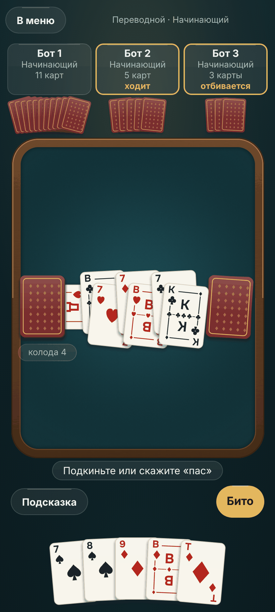
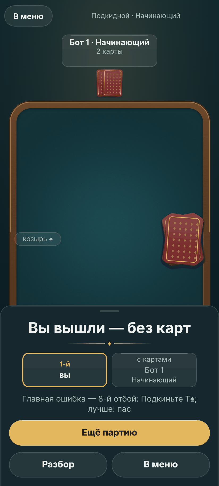

# Вид «Козыря» — лист стиля

Лист стиля по правилу 2 [ADR 0023 устава](https://github.com/Nefeste/gornitsa/blob/main/adr/0023-graphics.md):
силуэты, палитра, свет, камера, эталонные кадры и чего в виде нет. Облик — свой, не брендбук студии
(ADR [0012](adr/0012-own-look.md), решение владельца): тёмное сукно, стекло, тёплое золото главной кнопки. Карты
рисует код (ADR [0010](adr/0010-cards-in-code.md)). Числа геймдизайна — в [`09-game-design.md`](09-game-design.md),
здесь — только вид. Как проверять экраны по этому листу — навык `.claude/skills/redesign-existing-projects/`;
последний аудит — [`reports/2026-11-08-design-audit.md`](reports/2026-11-08-design-audit.md).

**Состояние.** Составлено 08.11.2026 по снимкам версии 0.4.1; шкалы §3–4 держит код и тест `theme.test.ts`.
09.11.2026 добавлены модель света, материалы, кривые движения и карта звуков по спецификации
[`specs/2026-11-art-premium.md`](specs/2026-11-art-premium.md); эталонные кадры §10 — на одобрение владельца.

## 1. Силуэты

- **Карта** — 63 × 88 (пропорция обычной колоды), скругление 8 dp при ширине 68 dp; лицо светлое (`face`) с тонкой
  линией (`faceLine`), тень снизу (`shadow`). Индекс в двух углах: русские **В, Д, К, Т**, 6–10, под ним масть.
- **Картинки (В, Д, К)** — буква в рамке и **орнамент масти**; фигур людей нет. С 08.11.2026 предложен (ждёт одобрения
  владельца, ADR устава 0023) «двуглавый» вид, как у настоящих фигур, но буквой (`courtArt` в `src/render/faces.ts`):
  рамка-картуш, по середине — перевязь с мастями (у В одна, у Д две, у К три — картинки различаются не только буквой),
  на её концах и в открытых углах рамки — масть и ромбик; буква в верхней половине и та же вверх ногами в нижней, как
  индекс в углах. Углы рамки у индексов уходят под «ярлык» индекса цвета лица — индекс всегда читается целиком, и в
  веере руки на видимой полоске карты остаются индекс и верх буквы. Лист «до — после» —
  `docs/design/2026-11-court-cards/` (`tools/design/deck.ts`, веб-сборка с `?deck=1`).
- **Рубашка** — бордо (`back`) с золотой рамкой (`backLine`) и мелким узором из ромбов.
- **Рука** — веер у нижнего края, карты перекрываются, но индекс каждой виден целиком.
- **Стол** — прямоугольник сукна со скруглением 20 dp во всю ширину экрана без полей 16 dp; ничто не выходит за его край.
- **Места соперников** — сверху, по одному на соперника: стеклянная плашка — медальон места (у бота — портрет с
  подписью «бот», §11; у человека — первая буква имени), имя, уровень, число карт («вышел»), каждая надпись своей
  строкой (§3 «Надписи целиком»), под ней рубашки веером. Кто ходит — значок «стрелка к столу», кто
  отбивается — «щит» (без оружия), чья очередь подкидывать — «плюс», слева от числа карт, золотом `accent`, 14 dp; пустой строки роли нет. Значки рисует
  код (`src/ui/RoleIcon.tsx`), различаются формой; слово — их голос для чтения с экрана.
- **Реплика** — капсула `sheet` с кромкой `line`, текст 15/700 `text`, поверх веера соперника или над рукой;
  «думает…» — та же капсула стеклом `glass`, текст `dim`. Не стоит на картах стола.
- **Рука вразброс** — поворот ±1,5° и сдвиг ±2 dp по номеру карты (неподвижно); «Ровная рука» — по линейке.
- **Кнопка порядка руки** — круг стекла 40 dp слева от руки, значок 20 dp: три масти или ступеньки.

## 2. Палитра — токены `src/ui/theme.ts`

| Токен | Роль | Где нельзя |
|---|---|---|
| `bg` | фон экрана | — |
| `felt`, `feltLight`, `feltEdge` | сукно: светлее к середине, темнее к кромке | под текстом интерфейса вне стола |
| `glass`, `glassLine` | стекло панелей и вторичных кнопок, 1 px кромка | поверх карт |
| `sheet`, `line` | окна и листы снизу | — |
| `text`, `dim` | основной и второстепенный текст | `dim` для главного действия |
| `accent`, `accentText` | **одно** главное действие экрана; выбранное | рядом две золотые заливки |
| `face`, `faceLine`, `red`, `black` | лица карт и масти | интерфейс вне карт |
| `green`, `blue` | масти четырёхцветной колоды | вне карт |
| `back`, `backLine` | рубашка | — |
| `glow` | подсветка места, куда ляжет карта, и выбранной карты | украшения |
| `ok`, `danger` | «Колода проверена», ошибка | декор |
| `shadow` | тень карты | текст |
| `sky`, `lamp`, `cool` | фон комнаты: верх неба, тёплое пятно лампы, холодный отсвет внизу (`Backdrop.tsx`) | под текстом без стекла или листа |
| `wood`, `woodLight`, `woodDark` | борт стола: дерево, свет сверху, тень снизу | интерфейс вне стола |
| `shine` | блик по верхней кромке стекла и золотой кнопки, 1 px | заливки |
| `PORTRAIT`: `ground`, `skin`, `shade`, `hair`, `cloth`, `ink`, `metal`, `linen` | портреты соперников (§11): сукно медальона, три тона лица и тень шеи, семь цветов волос, восемь «нитей» одежды, глаза и оправа, серьги, воротник | интерфейс вне портретов; золота `accent` среди них нет |

Правила: одно золото на экране означает «главное»; выбранный вариант в ряду — **контур и текст золотом на стекле**, а
не заливка, чтобы не спорить с главной кнопкой. Новые цвета — только новым токеном здесь и в `theme.ts`; тёмное
затемнение под окном (`dialog.tsx`) переносится в токен `scrim`.

## 3. Шрифт и размеры

Onest (OFL, `assets/fonts/`), 400, 500, 700; без курсива. Шкала (sp): **13** подпись, **15** текст, **17** кнопка и
выделенное, **20** заголовок раздела, **28** заголовок экрана, **40** название игры. Числа (карты, колода, шанс) —
моноширинными цифрами. Кнопки не обрезаются при крупном шрифте телефона ×1,3. Заголовок экрана — один вид на всех
экранах: 28, 700, `text`; кнопка «Назад» — вверху слева.

### Надписи целиком

Решение владельца 09.11.2026: «нигде на элементах управления не должно быть обрезания надписей». Правило — для
**каждой** надписи игры: кнопки, ряды вариантов, переключатели, «‹ уровень ›», плашки соперников, ячейки схемы мест,
шапки, листы и окна, подписи картинок.

- **Нет многоточия и нет обрезки.** Ни `numberOfLines`, ни `ellipsizeMode`, ни ужимания шрифта
  (`adjustsFontSizeToFit`) — тест `tools/test/fit.test.ts`. Никакая рамка с постоянной высотой или шириной не держит
  текст, который может в неё не влезть.
- **Не помещается — переносится, раскладка подстраивается.** Кнопка становится выше, ячейка схемы — тоже, подпись
  картинки — в столько строк, сколько нужно (высота ряда — по самой высокой). Где места мало заранее, раскладка
  меняется по правилу, а не по случаю:
  - **плашка соперника** — каждая надпись своей строкой: имя, уровень (онлайн — «играет бот» или «нет связи»), число
    карт, роль. С тремя соперниками на телефоне число карт — значком карты с цифрой справа от портрета (§11). Раньше вчетвером уровень и карты шли одной строкой, и «Опытный · 6 карт» обрезалось до «Опытный · 6 ка…».
    Высоту под плашку стол держит заранее — по числу строк и шрифту телефона (`plateHeight`), поэтому стол не прыгает;
  - **ник длиннее места** — переносится между любыми буквами (невидимый пробел после каждой буквы в словах длиннее
    восьми знаков, `breakable`), плашка растёт вниз, на рубашки веера; сокращений и «…» нет;
  - **верхняя полоса стола** — только название стола: уровни — на плашках;
  - **«Разные уровни»** — соперник (портрет, имя, характер) над своей строкой «‹ уровень ›», а не слева от неё, на
    любом телефоне.
  - **подсказка и кнопки над рукой** стоят на зазоре 8 над рукой и растут вверх, на сукно: длинная подсказка (строка
    задачи дня, подсказка новичка) или крупный шрифт не ложатся на карты руки.
- **Крупный шрифт телефона.** Приложение не запрещает его, но ограничивает рост там, где место задано столом:
  кнопки, «‹ уровень ›», шапки, окна, плашки и подписи «Сыграно» / «Лучше» растут до **×1,3**
  (`maxFontSizeMultiplier`), название стола в верхней полосе — до **×1,15** (на 360 точках рядом помещаются «В меню»
  и «Вышедшие»). Остальной текст (правила, магазин, отчёт, статистика) растёт без предела и переносится — эти экраны
  прокручиваются.
- **Проверка.** `tools/e2e/fit.ts` проходит экраны и состояния стола (меню с 1–3 ботами и «Разными уровнями» с самым
  длинным названием уровня, стол на 2–4 места, «Что такое перевод», «Вышедшие», подсказка, итог, разбор, правила,
  настройки, отчёт, магазин, статистика, задача дня и архив, профиль онлайна; с `--online` — ошибка сервера, «С
  друзьями», сбор стола, выбор места, стол вчетвером с ником в 16 знаков, быстрая игра) на 360 × 740 и 412 × 915,
  шрифтом ×1 и ×1,3, и падает на любой надписи, которая шире или выше своей рамки, уходит за край обрезающего
  родителя, вылезает из своего места, за край экрана или лежит на карте руки.

### Главное действие внизу

Решение владельца 09.11.2026 (аудит интерфейса, вопросы 1–3): главное действие экрана, который длиннее телефона, —
закреплённой полосой внизу над кнопками телефона (`src/ui/BottomBar.tsx`): «Играть» в меню, «Начать» в сборе стола.
Полоса — непрозрачный лист `sheet` с кромкой стекла и бликом сверху, скругление панели по верхним углам, как лист
итога; экран прокручивается над ней, нижнее поле прокрутки — высота полосы, поэтому последний ряд встаёт над ней.
Выбор уровня бота — везде одной строкой «‹ уровень ›» (`Stepper`) с закрытым «Мастер · скоро»: меню, «С друзьями»,
сбор стола.

## 4. Отступы и скругления

Отступы (dp): **4, 8, 12, 16, 24, 32, 48**; поля экрана 16 (уже 380 dp — 12); внутри группы 8, между группами 24.
Скругления (dp): карта **8**, малые (ряд вариантов, маленькие кнопки) **12**, панели и листы **20**, кнопки —
капсула. Вложенная форма при зазоре меньше 32: внутренний радиус = внешний − зазор.

## 5. Свет и материалы

Одна картина — **тёмная комната, над столом тёплая лампа**, чуть ближе к игроку. Из неё выводится всё
(`specs/2026-11-art-premium.md`, §2):

- **Комната** — фон под всеми экранами (`src/ui/Backdrop.tsx`): ночная хвоя сверху вниз (`sky` → `bg`), тёплое
  пятно лампы в верхней трети (`lamp`), холодный отсвет внизу (`cool`). Рисуется один раз и не двигается; экраны
  поверх прозрачны.
- **Сукно** — матовое с мелкой фактурой (зерно и переплетение, ±4 % яркости): пятно света `feltLight` под лампой
  (середина по ширине, ≈ 0,47 высоты стола), к кромке — `felt` и `feltEdge`, в углах виньетка. **Борт** — дерево
  14 dp с толщиной: волокна вдоль борта (`wood`), свет сверху (`woodLight`) и тень снизу (`woodDark`), тёмная
  внешняя кромка, светлая фаска по верху, внутренняя тень борта на сукне. Всё записано один раз в картинку стола
  (`src/render/felt.ts`, спецификация «Круг 2»). Это карточный стол в комнате, не казино.
- **Карты** — бумага: лицо `face` с линией `faceLine`, едва заметный скос света сверху; под картой мягкая тень вниз на
  5 % ширины карты, светлее к краям — стопка скруглённых прямоугольников в той же картинке, что лицо (ничего не
  размывается на кадр).
- **Стекло** — заливка `glass`, кромка `glassLine` 1 px, блик `shine` по верхней кромке; размытия нет (фон под
  стеклом неподвижен — как в «Нардах», ADR 0021).
- **Золото** — главная кнопка экрана (капсула `accent` с бликом `shine`), рамка рубашки, подсветка мест и «ходит» у
  соперника. Никаких золотых фишек, блёсток, «джекпотов», движущихся бликов и отражений.

## 6. Стол: раскладка на 2, 3 и 4 места

- **Вдвоём** — соперник сверху по центру; колода с козырем — в левом верхнем углу сукна, сброс — в правом, оба ×0,8;
  атака и отбой — по центру под ними, ряд до 3 пар, второй ряд ниже (с 09.11.2026: колода слева посередине
  перекрывалась уже второй парой).
- **Втроём и вчетвером** — соперники сверху в ряд, места равной ширины; у того, кто ходит или отбивается, — золотая
  кромка и значок; карты на столе — те же, что вдвоём.
- **Подсказка** — одна строка над рукой; кнопки действий («Беру», «Бито», «Пас», «Перевести») — одной линией над
  рукой справа, одного размера, ≥ 48 dp.
- **Верхняя полоса** — «В меню» слева, вид стола стеклянной подписью по центру (уровни — на плашках), одно действие
  справа; «Подсказка», «Отменить», «Вышедшие» — в меню партии, если не помещаются на 360 dp.
- **HUD** — подсказка и подпись колоды — стеклянные капсулы в строку, длинная подсказка — в две, без обрезки
  (§3 «Надписи целиком»); плашки мест — стекло с бликом, у ходящего — золотая кромка; на столе ничего не стоит поверх карт, кроме подсветки места.
- **Итог** — лист снизу (`sheet`, радиус 20, блик по кромке) над рукой: исход заголовком, строка «кто вышел и кто
  остался», строка главной ошибки, «Ещё партию» золотом, «Разбор» и «В меню» стеклом; стол за листом виден.

## 7. Движение

Числа — `09-game-design.md`, «Темп». Кривые: полёт карты 180 мс `Easing.out(cubic)`, раздача 1,2 с ступенями по
порядку карт, без пружин и перелёта; карта и её тень приходят вместе; после настоящего полёта — посадка: на миг
крупнее на 5 % и садится за 120 мс, сдвиг веера — без неё. Реплика за столом — проявление 150 мс и угасание 200 мс,
без сдвига и подскока. Лист итога — 250 мс снизу той же
кривой; окна — проявление. Цвет и прозрачность 150–250 мс. Нажатие кнопки — 0,85 и 1 dp вниз; недоступная — 0,4 без
золота. **«Меньше движения»** — карты сразу на месте, лист и реплики появляются и пропадают без проявления; ничто не мигает и не двигается без действия
игрока. Неверное касание — спокойная строка «так нельзя», без тряски.

## 8. Звук

Записи CC0 с источником в `assets/sounds/SOURCES.md`; числа и громкости — `09-game-design.md`, «Звук».

| Событие | Звук | Вибрация |
|---|---|---|
| раздача новой партии | тасовка | — |
| карта легла на стол (своя, соперника, перевод) | шлепок, через полёт | своя карта |
| «бито» | шорох | если вы ходили или отбивались |
| «беру» | мягкий веер | свой «беру» |
| касание кнопки, итог партии | **нет** (кандидаты на позже: только CC0, тихо, выключается «Звуком») | — |

## 9. Чего в виде нет

Фигур людей на картах (портреты соперников — на плашках мест, §11), фотографий, стоков и картинок из генераторов, 3D-стола, «казино» (золото фишек, блёстки,
неон), мигания и тряски без действия, счётчиков и таймеров, которые торопят, градиентов на тексте, второго шрифта
без решения владельца, брендбука студии вне «Об игре».

## 10. Эталонные кадры — круг 1 одобрен (#54), круг 2 ждёт одобрения владельца в PR

Агент предлагает, владелец одобряет или меняет в PR (ADR устава 0023, правило 2; `Nefeste/uprava#76`). Снимки —
`tools/design/flow.ts` (веб-сборка, 412 × 915, ×2, закреплённая колода `?seed=11`). Круг 1 — `docs/design/2026-11-art/`
(направление одобрено 09.11.2026: комната с лампой, борт, стекло, тени карт). Круг 2 — `docs/design/2026-11-art-2/`:
стол как материал и итог как событие; листы «до — после» — `sheet-*.png` там же.

| Кадр | Почему этот |
|---|---|
|  | вход в игру: комната с лампой, знак из карт, золото только у «Играть» (круг 1, одобрен) |
|  | переводной вчетвером в разгар отбоя, та же раздача, что в «до»: борт с толщиной, фактура сукна, свет лампы, тени карт, два ряда пар, плашки мест, подсказка |
|  | конец партии как событие: строка-герой, золотая линия, ряд мест по порядку выхода, главная ошибка текстом, «Ещё партию» |

Кадры прошлых листов остаются в `docs/design/` как история.

## 11. Портреты соперников

Решение владельца [#20](https://github.com/Nefeste/durak/issues/20), ADR [0014](adr/0014-rivals-with-names.md): у
бота — имя и лицо. Портрет рисует код (`src/game/Portrait.tsx`, фигуры `react-native-svg`), состав и вид каждого —
`src/game/rivals.ts`; кто есть кто — [`09-game-design.md`](09-game-design.md), «Соперники с именами». Лист всего
состава — `docs/design/2026-11-rivals/cast.png` (`tools/design/cast.ts`, веб-сборка с `?cast=1`).

- **Медальон** — скруглённый квадрат (радиус 12, как малые формы; не круг), сукно `PORTRAIT.ground` с кромкой стекла
  1 px и бликом по верху — как окно в стекле плашки. Один фон у всех: персонажа различает силуэт, а не цвет рамки.
- **Силуэт** — погрудный, анфас, плоскими формами без контура и без теней: плечи цветом одежды, шея тоном темнее
  лица, лицо, **причёска** (десять видов: короткая, пробор, назад, кудри, каре, длинные, пучок, хвост, два хвостика,
  лысина) и **одна-две детали** (очки круглые или прямоугольные, усы, борода, бородка, кепка, серьги, веснушки,
  ободок, воротник, шаль). Причёска и детали у каждого из 21 персонажа — свои, одежда трёх персонажей уровня — трёх
  разных цветов: за одним столом их не спутать и в 34 точки (тест `rivals.test.ts`).
- **Лицо** — две точки глаз и короткая улыбка; у кого усы или борода — без рта. Спокойные и дружелюбные: не шарж,
  не пин-ап, без возраста «напоказ» — старших выдают седина, кепка и очки.
- **Палитра** — `PORTRAIT` в `theme.ts`: приглушённые «нити» под ночную хвою стола; золота главной кнопки среди
  них нет (оно значит «главное действие»), градиентов и прозрачности нет.
- **Подпись «бот»** — капсула `sheet` с кромкой стекла, 13/700 `dim`; стоит внахлёст на нижнюю кромку медальона
  (8 dp, закрывает плечи, не подбородок) — портрет и подпись читаются одной вещью. Без неё портрет бота не
  показывается нигде. Растёт с шрифтом телефона до ×1,3, медальон не растёт.
- **Человек** — такой же медальон стеклом `glass` с первой буквой имени (17/700 `dim`), без рисунка и без подписи.
- **Размеры.** 44 dp — на широкой плашке, слева от надписей (36 — если плашка уже 176 dp: два соперника на 360 dp);
  34 dp — на узкой; 36 dp — в итоге, схеме мест и меню.
- **Плашка стола** (`SeatPlate`, `plateOf`):
  - **широкая** — плашка не уже 166 dp (один-два соперника на 360 и 412 dp): медальон слева, справа столбцом от
    левого края — имя, уровень, число карт со значком роли. Высота прежняя — 64 dp (×1,3 — 81): надписи выше
    медальона с подписью. Надписям остаётся не меньше 110 dp — «Начинающий» шрифтом ×1,3 (`fit.test.ts`);
  - **узкая** — три соперника на телефоне (плашка 109 dp на 360, 126 на 412): в верхнем ряду медальон 34, справа от
    него «бот» и под ним число карт **значком карты рубашкой с цифрой** («6 карт» — голосом; «вышел», «сдался» —
    словом); ниже во всю ширину — имя и уровень. Так «Начинающий» шрифтом ×1,3 помещается целиком, а плашка выше
    прежней на одну строку: 81 dp вместо 64 (×1,3 — 102). Портрет над тремя строками стоил бы 115 dp, и шесть пар в
    два ряда на 360 × 740 стали бы меньше 0,65 карты — тест `table.test.ts` держит прежние пределы (0,85 и 0,65).
- **Итог** — плашка места: медальон слева, справа «1-й» и имя, уровень — строкой ниже во всю ширину плашки (как
  на узкой плашке стола); не больше двух плашек в ряд.
- **Меню и схема мест** — медальон 36: в меню слева от имени и строки характера, в ячейке схемы — над именем.
- **Движение** — портрет неподвижен: не моргает, не кивает, не «реагирует» (§7, «Меньше движения» менять нечего).
- **Чего нет**: фотографий и картинок из генераторов, чужих персонажей, взрослых образов (решение о них — вместе с
  рубашками 18+, после 1.0), рамок «редкости», уровней и званий на портрете.
