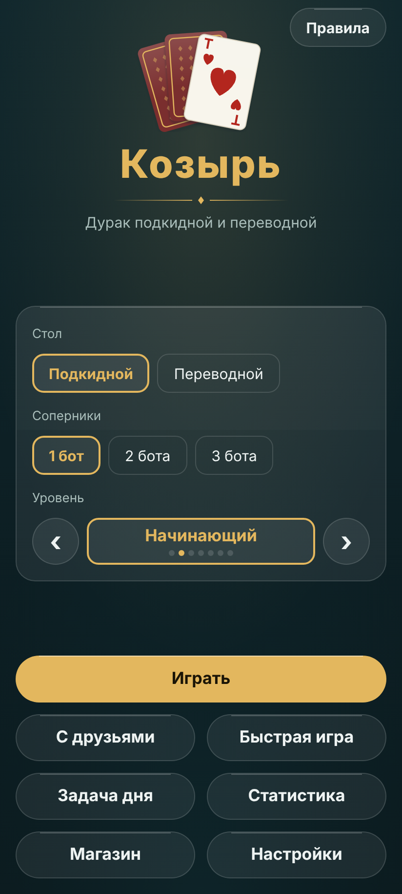
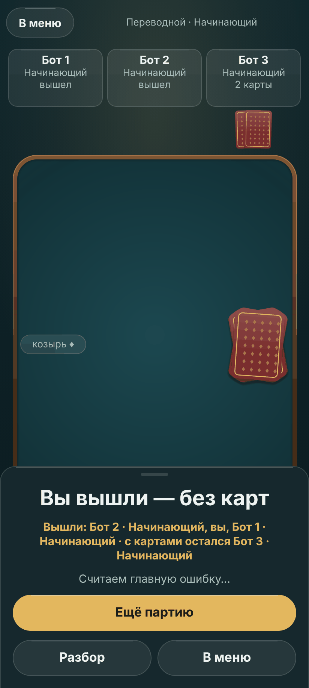
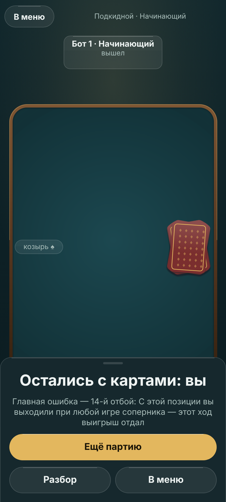

# Вид «Козыря» — лист стиля

Лист стиля по правилу 2 [ADR 0023 устава](https://github.com/Nefeste/gornitsa/blob/main/adr/0023-graphics.md):
силуэты, палитра, свет, камера, эталонные кадры и чего в виде нет. Облик — свой, не брендбук студии
(ADR [0012](adr/0012-own-look.md), решение владельца): тёмное сукно, стекло, тёплое золото главной кнопки. Карты
рисует код (ADR [0010](adr/0010-cards-in-code.md)). Числа геймдизайна — в [`09-game-design.md`](09-game-design.md),
здесь — только вид. Как проверять экраны по этому листу — навык `.claude/skills/redesign-existing-projects/`;
последний аудит — [`reports/2026-11-08-design-audit.md`](reports/2026-11-08-design-audit.md).

**Состояние.** Составлено 08.11.2026 по снимкам версии 0.4.1; шкалы §3–4 держит код и тест `theme.test.ts`.
09.11.2026 добавлены модель света, материалы, кривые движения и карта звуков по спецификации
[`specs/2026-11-art-premium.md`](specs/2026-11-art-premium.md); эталонные кадры §10 — на одобрение владельца.

## 1. Силуэты

- **Карта** — 63 × 88 (пропорция обычной колоды), скругление 8 dp при ширине 68 dp; лицо светлое (`face`) с тонкой
  линией (`faceLine`), тень снизу (`shadow`). Индекс в двух углах: русские **В, Д, К, Т**, 6–10, под ним масть.
- **Картинки (В, Д, К)** — буква в рамке и **орнамент масти**; фигур людей нет. С 08.11.2026 предложен (ждёт одобрения
  владельца, ADR устава 0023) «двуглавый» вид, как у настоящих фигур, но буквой (`courtArt` в `src/render/faces.ts`):
  рамка-картуш, по середине — перевязь с мастями (у В одна, у Д две, у К три — картинки различаются не только буквой),
  на её концах и в открытых углах рамки — масть и ромбик; буква в верхней половине и та же вверх ногами в нижней, как
  индекс в углах. Углы рамки у индексов уходят под «ярлык» индекса цвета лица — индекс всегда читается целиком, и в
  веере руки на видимой полоске карты остаются индекс и верх буквы. Лист «до — после» —
  `docs/design/2026-11-court-cards/` (`tools/design/deck.ts`, веб-сборка с `?deck=1`).
- **Рубашка** — бордо (`back`) с золотой рамкой (`backLine`) и мелким узором из ромбов.
- **Рука** — веер у нижнего края, карты перекрываются, но индекс каждой виден целиком.
- **Стол** — прямоугольник сукна со скруглением 20 dp во всю ширину экрана без полей 16 dp; ничто не выходит за его край.
- **Места соперников** — сверху, по одному на соперника: имя, «бот», число карт, состояние («ходит», «отбивается»,
  «вышел»), рубашки веером.

## 2. Палитра — токены `src/ui/theme.ts`

| Токен | Роль | Где нельзя |
|---|---|---|
| `bg` | фон экрана | — |
| `felt`, `feltLight`, `feltEdge` | сукно: светлее к середине, темнее к кромке | под текстом интерфейса вне стола |
| `glass`, `glassLine` | стекло панелей и вторичных кнопок, 1 px кромка | поверх карт |
| `sheet`, `line` | окна и листы снизу | — |
| `text`, `dim` | основной и второстепенный текст | `dim` для главного действия |
| `accent`, `accentText` | **одно** главное действие экрана; выбранное | рядом две золотые заливки |
| `face`, `faceLine`, `red`, `black` | лица карт и масти | интерфейс вне карт |
| `green`, `blue` | масти четырёхцветной колоды | вне карт |
| `back`, `backLine` | рубашка | — |
| `glow` | подсветка места, куда ляжет карта, и выбранной карты | украшения |
| `ok`, `danger` | «Колода проверена», ошибка | декор |
| `shadow` | тень карты | текст |
| `sky`, `lamp`, `cool` | фон комнаты: верх неба, тёплое пятно лампы, холодный отсвет внизу (`Backdrop.tsx`) | под текстом без стекла или листа |
| `wood`, `woodLight`, `woodDark` | борт стола: дерево, свет сверху, тень снизу | интерфейс вне стола |
| `shine` | блик по верхней кромке стекла и золотой кнопки, 1 px | заливки |

Правила: одно золото на экране означает «главное»; выбранный вариант в ряду — **контур и текст золотом на стекле**, а
не заливка, чтобы не спорить с главной кнопкой. Новые цвета — только новым токеном здесь и в `theme.ts`; тёмное
затемнение под окном (`dialog.tsx`) переносится в токен `scrim`.

## 3. Шрифт и размеры

Onest (OFL, `assets/fonts/`), 400, 500, 700; без курсива. Шкала (sp): **13** подпись, **15** текст, **17** кнопка и
выделенное, **20** заголовок раздела, **28** заголовок экрана, **40** название игры. Числа (карты, колода, шанс) —
моноширинными цифрами. Кнопки не обрезаются при крупном шрифте телефона ×1,3. Заголовок экрана — один вид на всех
экранах: 28, 700, `text`; кнопка «Назад» — вверху слева.

## 4. Отступы и скругления

Отступы (dp): **4, 8, 12, 16, 24, 32, 48**; поля экрана 16 (уже 380 dp — 12); внутри группы 8, между группами 24.
Скругления (dp): карта **8**, малые (ряд вариантов, маленькие кнопки) **12**, панели и листы **20**, кнопки —
капсула. Вложенная форма при зазоре меньше 32: внутренний радиус = внешний − зазор.

## 5. Свет и материалы

Одна картина — **тёмная комната, над столом тёплая лампа**, чуть ближе к игроку. Из неё выводится всё
(`specs/2026-11-art-premium.md`, §2):

- **Комната** — фон под всеми экранами (`src/ui/Backdrop.tsx`): ночная хвоя сверху вниз (`sky` → `bg`), тёплое
  пятно лампы в верхней трети (`lamp`), холодный отсвет внизу (`cool`). Рисуется один раз и не двигается; экраны
  поверх прозрачны.
- **Сукно** — матовое: радиальное пятно света `feltLight` под лампой (середина по ширине, ≈ 0,45 высоты стола), к
  кромке — `feltEdge`, в углах виньетка. **Борт** — узкая деревянная кромка 6 dp (`wood`; `woodLight` сверху,
  `woodDark` снизу), внутри — тёмная линия тени на сукне. Это карточный стол в комнате, не казино.
- **Карты** — бумага: лицо `face` с линией `faceLine`, едва заметный скос света сверху; под картой мягкая тень вниз на
  2–3 dp, светлее к краям — стопка скруглённых прямоугольников в той же картинке, что лицо (ничего не размывается на
  кадр).
- **Стекло** — заливка `glass`, кромка `glassLine` 1 px, блик `shine` по верхней кромке; размытия нет (фон под
  стеклом неподвижен — как в «Нардах», ADR 0021).
- **Золото** — главная кнопка экрана (капсула `accent` с бликом `shine`), рамка рубашки, подсветка мест и «ходит» у
  соперника. Никаких золотых фишек, блёсток, «джекпотов», движущихся бликов и отражений.

## 6. Стол: раскладка на 2, 3 и 4 места

- **Вдвоём** — соперник сверху по центру; колода с козырем слева на уровне середины, сброс справа; атака и отбой —
  по центру, ряд до 3 пар, второй ряд ниже.
- **Втроём и вчетвером** — соперники сверху в ряд, места равной ширины; у того, кто ходит или отбивается, — золотая
  метка и строка состояния; карты на столе — те же, что вдвоём.
- **Подсказка** — одна строка над рукой; кнопки действий («Беру», «Бито», «Пас», «Перевести») — одной линией над
  рукой справа, одного размера, ≥ 48 dp.
- **Верхняя полоса** — «В меню» слева, вид и уровень стеклянной подписью по центру, одно действие справа;
  «Подсказка», «Отменить», «Вышедшие» — в меню партии, если не помещаются на 360 dp.
- **HUD** — подсказка и подпись колоды — стеклянные капсулы, одна строка, без обрезки; плашки мест — стекло с бликом,
  у ходящего — золотая кромка; на столе ничего не стоит поверх карт, кроме подсветки места.
- **Итог** — лист снизу (`sheet`, радиус 20, блик по кромке) над рукой: исход заголовком, строка «кто вышел и кто
  остался», строка главной ошибки, «Ещё партию» золотом, «Разбор» и «В меню» стеклом; стол за листом виден.

## 7. Движение

Числа — `09-game-design.md`, «Темп». Кривые: полёт карты 180 мс `Easing.out(cubic)`, раздача 1,2 с ступенями по
порядку карт, без пружин и перелёта; карта и её тень приходят вместе, без отскока. Лист итога — 250 мс снизу той же
кривой; окна — проявление. Цвет и прозрачность 150–250 мс. Нажатие кнопки — 0,85 и 1 dp вниз; недоступная — 0,4 без
золота. **«Меньше движения»** — карты сразу на месте, лист появляется; ничто не мигает и не двигается без действия
игрока. Неверное касание — спокойная строка «так нельзя», без тряски.

## 8. Звук

Записи CC0 с источником в `assets/sounds/SOURCES.md`; числа и громкости — `09-game-design.md`, «Звук».

| Событие | Звук | Вибрация |
|---|---|---|
| раздача новой партии | тасовка | — |
| карта легла на стол (своя, соперника, перевод) | шлепок, через полёт | своя карта |
| «бито» | шорох | если вы ходили или отбивались |
| «беру» | мягкий веер | свой «беру» |
| касание кнопки, итог партии | **нет** (кандидаты на позже: только CC0, тихо, выключается «Звуком») | — |

## 9. Чего в виде нет

Фигур людей на картах, фотографий, стоков и картинок из генераторов, 3D-стола, «казино» (золото фишек, блёстки,
неон), мигания и тряски без действия, счётчиков и таймеров, которые торопят, градиентов на тексте, второго шрифта
без решения владельца, брендбука студии вне «Об игре».

## 10. Эталонные кадры — предложено 09.11.2026, ждёт одобрения владельца в PR

Агент предлагает, владелец одобряет или меняет в PR (ADR устава 0023, правило 2; `Nefeste/uprava#76`). Снимки —
`tools/design/flow.ts` (веб-сборка, 412 × 915, ×2) из `docs/design/2026-11-art/`: «до» — версия 0.8.0, «после» —
по спецификации `specs/2026-11-art-premium.md`. Лист «до — после» каждого кадра — там же.

| Кадр | Почему этот |
|---|---|
|  | вход в игру: комната с лампой, фирменная шапка, золото только у «Играть», стекло у остальных |
|  | обычный стол в разгар отбоя: свет на сукне, борт, тени карт, плашки мест, подсказка и кнопка под пальцем |
|  | конец партии как событие: исход, кто вышел и кто остался, главная ошибка, «Ещё партию» |

Кадры прошлого листа (0.4.1: переводной вчетвером, отбой вдвоём, главный экран) остаются в `docs/design/` как история.
