# Арт «Козыря»: проходы самопроверки, 09.11.2026

По спецификации [`specs/2026-11-art-premium.md`](../specs/2026-11-art-premium.md), §7: веб-сборка, телефон 412 × 915,
плотность 2, скрипт `tools/design/flow.ts` — весь путь игрока, снимок каждого экрана, ошибки консоли. Снимки —
`docs/design/2026-11-art/`: `before/` — версия 0.8.0 (`tools/design/shots.ts`), `pass-1/`, `pass-2/` — после правок.
Каждый проход — критический разбор снимков: что выглядит дёшево, несбалансированно, съехало, не читается, дёргается;
потом правки и пересъёмка.

## Проход 1

**Сборка:** фон комнаты, сукно с пятном света и бортом, тени карт, стекло с бликом, шапка меню, капсулы подсказки и
колоды, итог событием. **Ошибок консоли:** 0, снимков 18 (`pass-1/`).

| До | После |
|---|---|
| 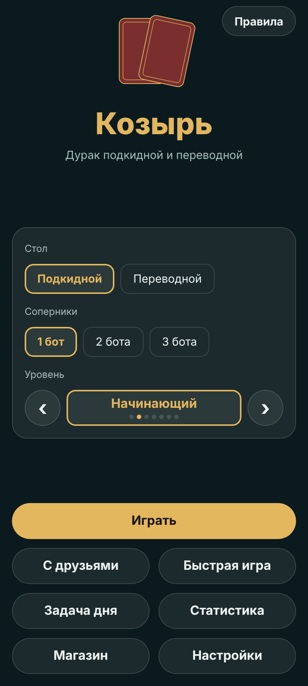 | 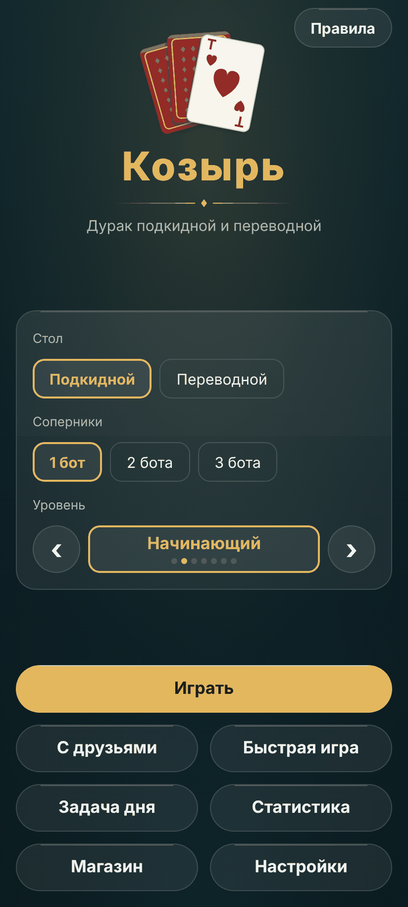 |
| 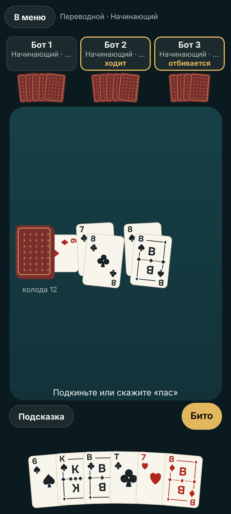 | 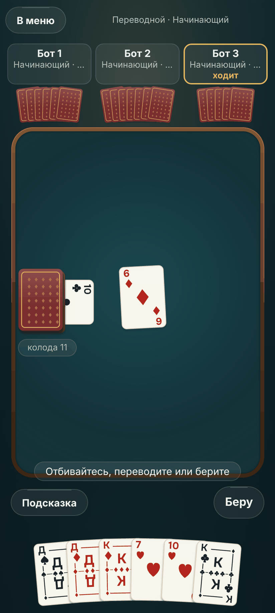 |
| 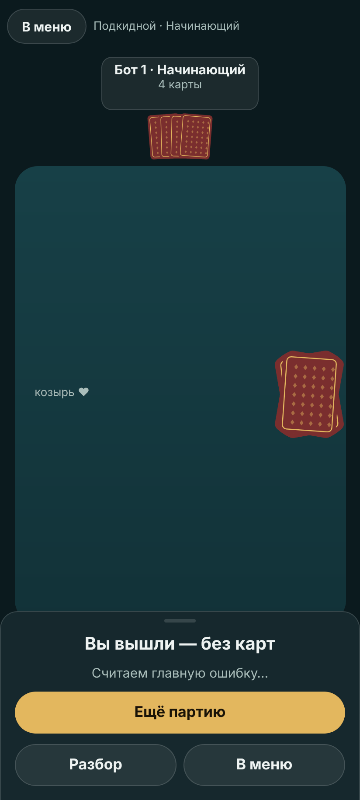 | 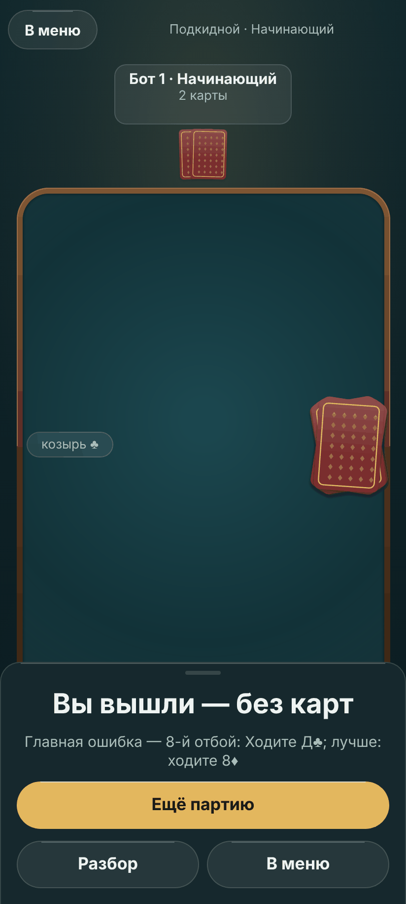 |

Что стало лучше: экран больше не плоский — лампа над столом читается на фоне и на сукне; борт даёт столу край; тени
отделяют карты от сукна (стопка сброса и колода выглядят стопками); шапка меню — знак, а не две рубашки; итог
читается как событие (заголовок 28, лист с бликом).

Что не так (важность как в аудите: А — мешает, Б — дёшево, В — шлифовка):

1. **А. Вчетвером в плашке обрезан уровень:** «Начинающий · …» (`16-table-four.png`). Обрезка запрещена
   (решение владельца 09.11.2026). *Правка:* уровень — своей строкой под именем, плашка выше (82 вместо 66) —
   `plateOf` в `src/render/layout.ts`, одна функция для раскладки и экранов.
2. **А. Капсула подсказки ложится на борт** («Отбивайтесь, переводите или берите» стоит на нижней кромке сукна).
   *Правка:* сукно кончается над строкой подсказки (`felt.h` в раскладке), а не под ней.
3. **Б. Нижняя половина сукна слишком тёмная**, пятно света узкое, виньетка давит: стол в середине партии читается
   как «светлый верх, чёрный низ». *Правка:* лампа в середине высоты стола, радиус пятна 0,9 большей стороны,
   виньетка 0,3 вместо 0,45.
4. **В. Плашки мест — без блика**, как обычные прямоугольники рядом со стеклом с бликом. *Правка:* плашка — тот же
   `Glass`.
5. **В. Снимок середины партии не снялся** (условие «две пары и пять карт» в быстром режиме не наступало).
   *Правка:* условие мягче — пара на столе и четыре карты в руке.
6. **В. Между шапкой меню и панелью — пустота** на высоком экране (915). Оставлено: панель и «Играть» под пальцем
   важнее; на телефоне 780 dp пустоты нет (сценарий `?inset=48`).

## Проход 2

**Сборка:** правки 1–5 прохода 1. **Ошибок консоли:** 0, снимков 19 (`pass-2/`, снят и `06-table-mid`).

| Проход 1 | Проход 2 |
|---|---|
|  | 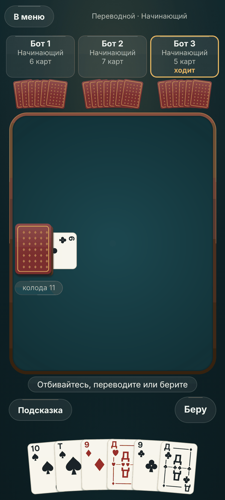 |
|  | 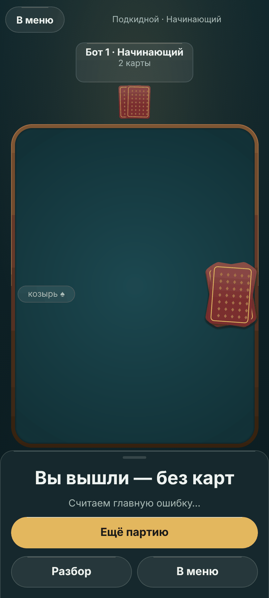 |

Что стало лучше: вчетвером в плашке «Бот 3 / Начинающий / 5 карт / ходит» — всё целиком; капсула подсказки стоит
под бортом, не на нём; сукно в середине партии ровнее освещено, стол читается как одно пятно света, а не «верх и
низ»; плашки — стекло с бликом, как остальные панели.

Что не так:

1. **А. Стопка сброса торчит за борт справа** (`07-result.png`, `19-puzzle.png`): карты сброса лежат вразброс до
   ±10°, а их середина стояла у самого края сукна — так было и до арта (аудит, находка 2 ловила только холст), с
   бортом стало видно. *Правка:* середина сброса на 0,15 ширины карты ближе к середине (`layout.ts`).
2. **В. В задаче дня подсказка — голым текстом** под сукном, не капсулой, как за столом. Оставлено: там две строки
   условия, капсула с двумя строками на 360 dp стала бы шире экрана; к задаче дня вернёмся отдельно.
3. **В. Снимок середины партии ловит карту бота в полёте** (`06-table-mid.png`: шестёрка над бортом) — это не
   дефект вида, а момент съёмки; для эталонного кадра стол снимается после паузы.
4. **В. Карты руки обрезаны нижним краем экрана** — так задумано (рука у нижней кромки, индексы видны целиком),
   не меняется.

## Итог — снимки `after/`

После правки 1 прохода 2 — пересъёмка в `after/` (`tools/design/flow.ts docs/design/2026-11-art/after`); из неё —
три эталонных кадра листа стиля (`frame-title.png`, `frame-table.png`, `frame-result.png`) и листы «до — после»
(`sheet-*.png`, `tools/design/deck.ts --pair`). Сквозной сценарий `tools/e2e/browser.ts` — на той же сборке.

Вторым коммитом PR реализации панели «Правил», «Настроек», «Статистики», «Магазина», «С друзьями» и «Разбора»
переведены на то же стекло с бликом (`Glass`); снимки — `after/10-settings.png`, `11-stats.png`, `12-store.png`,
`02-rules.png`, `09-review.png` (пересняты на ветке, слитой с `main` после #53 — новая статистика).

Что осталось на следующие PR (по спецификации §3): капсула подсказки в задаче дня, карты стола крупнее руки на 10 %
(нужна проверка шести пар на 360 dp), звук интерфейса — только если найдётся запись CC0.

# Круг 2 — 09.11.2026 (владелец: «да, запускай второй круг арта»)

Разбор первого круга от координатора: стол почти не изменился (борт — тонкая линия, пятно света едва видно, сукно
без материала), кадра «стол в середине партии» не было, итог — заголовок и абзацы акцентным цветом. Спецификация —
`specs/2026-11-art-premium.md`, «Круг 2». Снимки — `docs/design/2026-11-art-2/`: `before/` — `main` после #55 плюс
закреплённая колода (`?seed=11`, иначе «до» и «после» не ловят один стол), `pass-1/`, `pass-2/`, `after/`.

## Проход 1

**Сборка:** борт 14 dp с толщиной (волокна, фаска, внешняя кромка, внутренняя тень на сукне), сукно с фактурой
(SkSL, записано один раз в закадровую поверхность), тени карт плотнее, посадка карты, итог — ряд мест, кадр середины
партии. **Ошибок консоли:** 0, снимков 19.

| До (0.8.0 + #55) | Проход 1 |
|---|---|
| 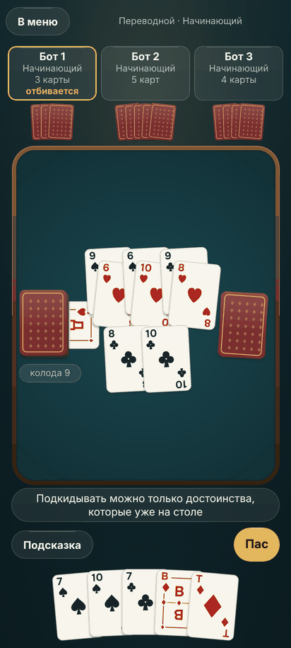 | 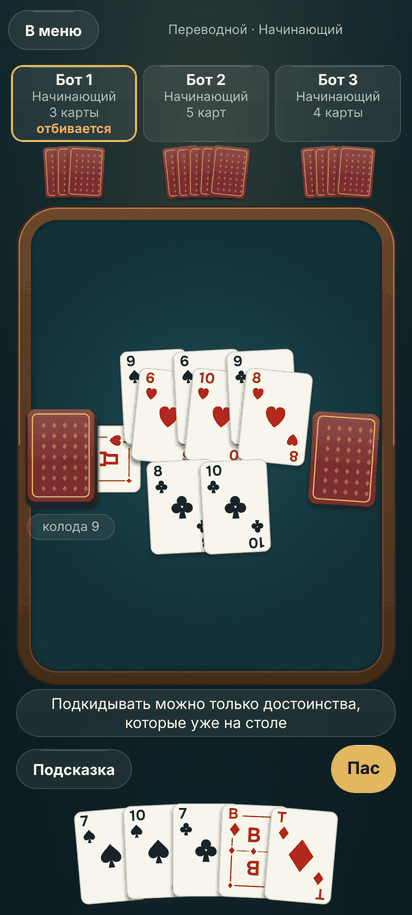 |
| 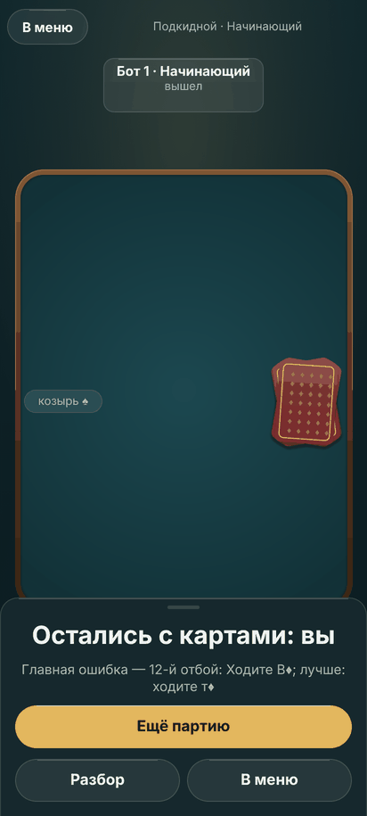 | 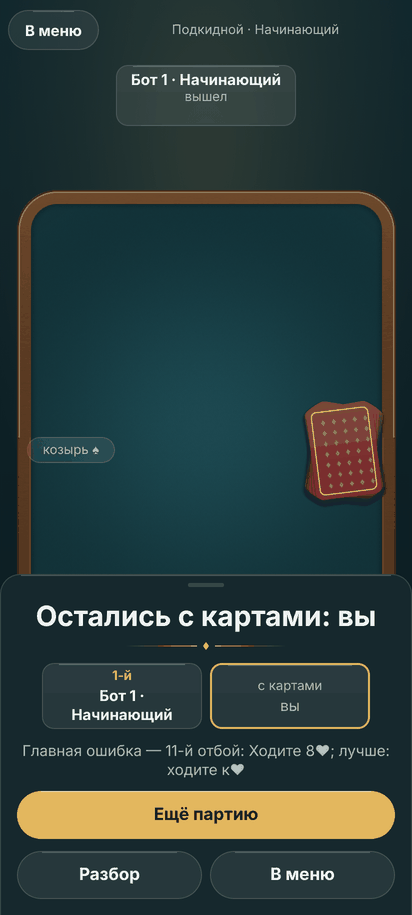 |

Что стало лучше: стол получил присутствие — борт читается деревом с толщиной, сукно — материалом, не заливкой, пятно
света видно; тени отделяют карты от сукна; итог — ряд мест, кто вышел и кто остался.

Что не так:

1. **А. Второй ряд пар на столе накрывает карты защиты первого ряда** («до» и «после» одинаково: ряды на 0,92
   высоты пары, карта защиты сдвинута вниз на 0,22) — читается только атака. *Правка:* ряды на 1,45 высоты карты
   (`layout.ts`).
2. **Б. В плашке места «Бот 1 · Начинающий» переносится с висящей точкой** — две строки в узкой плашке. *Правка:*
   имя и уровень разными строками (`ResultPlace.sub`), плашка выше.
3. **Б. Своя плашка «с картами» в золотой кромке** — как награда за проигрыш. *Правка:* золотая кромка только у
   своего места среди вышедших; плашка «с картами» всегда спокойная.
4. **В. Фактура сукна на снимке едва видна** при плотности 2. *Правка:* зерно ±5 %, переплетение ±2 % (было ±4 и
   ±1,5).
5. **В. Строка подсказки в кадре середины партии — объяснение неверного касания** (сценарий трогает карты подряд);
   это поведение игры, не вида — оставлено.

## Проход 2

**Сборка:** правки 1–4 прохода 1. **Ошибок консоли:** 0, снимков 19 (`pass-2/`). Первый прогон прохода 2 упал по
времени в `toEnd` под чужой нагрузкой (две партии Playwright на машине); в `flow.ts` добавлен сторож: стол не меняется
40 шагов — снимок `stall` и выход; повторный прогон прошёл.

| Проход 1 | Проход 2 |
|---|---|
|  | 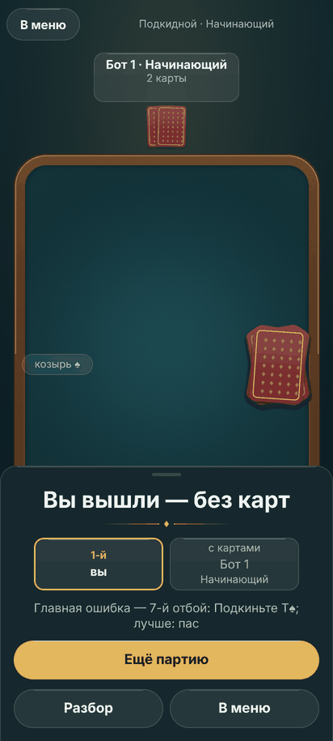 |

Что стало лучше: плашки мест — имя и уровень разными строками, ничего не переносится; своё место золотом только среди
вышедших; фактура сукна видна на снимке; ряды пар не накрывают друг друга (видно в `after/17-table-four-mid.png`).

Что не так:

1. **В. Кадр середины партии вчетвером поймал один отбой с одной парой** — условие «две пары» сработало в момент, когда
   отбой уже уходил. *Правка:* кадр снимается, когда на столе не меньше двух пар **и есть покрытая** (подсказка про
   подкидывание или «бито»); повтор — в `after/`, три покрытые пары.
2. **В. «До» и «после» — одна колода, но не всегда один и тот же отбой**: решения ботов детерминированы, а момент
   касания сценария — нет (паузы ботов в быстром режиме 60 мс против скорости кликов), партия может разойтись на
   отбой. Для листа «до — после» это та же раздача и та же фаза; строгое совпадение потребовало бы записи ходов —
   на следующий круг.
3. **В. Снимок середины партии вдвоём в `after/` не снялся** (партия кончилась раньше двух покрытых пар) — кадр стола
   взят вчетвером.

## Итог круга 2 — `after/`

Эталонные кадры листа стиля §10: `frame-table.png` (переводной вчетвером, три покрытые пары) и `frame-result.png`;
листы «до — после»: `sheet-table.png`, `sheet-result.png`, `sheet-deal.png`. Сквозной сценарий `tools/e2e/browser.ts`
на той же сборке — «Сценарий пройден».

**Цена кадра.** До круга 2 сукно было одним `drawRRect` с градиентом внутри `SkPicture`; теперь — одним
`drawImageRect` картинки, записанной один раз при смене размера стола (шейдер SkSL считается только тогда, в закадровой
поверхности ×2, ≈ 790 × 1800 пикселей, ~5,7 МБ в памяти картинок — в бюджете 30 МБ спецификации 1.0). Тени карт —
по-прежнему часть картинки лица. Посадка карты — та же `withTiming`, что полёт, плюс один шаг `withSequence`. В
браузерном «Замере» (программная отрисовка, шумно) числа тех же порядков, что в круге 1 (раздача вчетвером: медиана
50–67 мс и до, и после); мерило — телефон владельца.

Осталось на следующие PR: запись ходов для строго одинаковых кадров «до — после»; капсула подсказки в задаче дня; звук
интерфейса — только с записью CC0.
